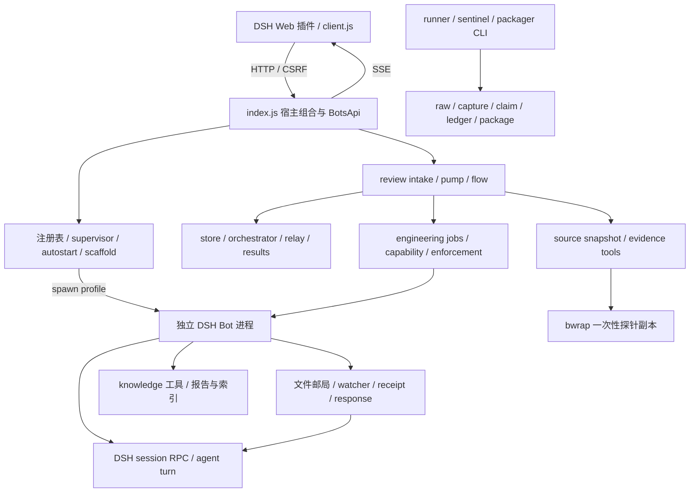

# 全图代码质量与架构评估（2026-09-05）

> 性质：当前仓库盘面评估与改进建议。本文不改变 PLAN 门态，不构成 P9 正式双席验收、部署许可或修复方案冻结。
> 授权：用户要求“读取本项目全部文件做一个全图代码质量评估以及架构评估”。
> 基线：本轮新增材料前 184 个文件；逐文件 SHA-256、大小、行数、语法与结构核验见 [inventory.json](/home/beijong/project/dsh-bots/artifacts/quality-review-2026-09-05/inventory.json)。

## 1. 结论

项目已形成适合单机、小规模 Bot 团队的完整功能骨架，配置复用、评审工件、权限绑定和证据工具链有明显工程积累。但当前版本仍有多项可以确定复现的消息丢失与评审流程阻断问题，不能据“49/49 测试文件通过”推导为无人值守可靠。

最优先的问题是生产编排：单个文件写成功、单个组件校验成功之后，下一步失败如何恢复，没有形成一致规则。普通邮局、生命周期、评审 flow 都出现了同类问题。应先修复实际行为并以宿主入口测试约束，再按状态所有权调整模块边界。

本次登记 19 项代码发现：12 项 P1、6 项 P2、1 项 P3。P1 表示主要工作流阻断、消息/更新丢失或违背显式停止意图，应先处理；不是宣称全部为安全漏洞。编号 QA-01 至 QA-19 仅属于本报告，不占用冻结 F-RV 编号。

| 维度 | 评价 | 依据 |
|---|---|---|
| 功能组织 | 较完整 | 多 profile、邮局、知识库、评审、工程任务、证据打包均有实现 |
| 正确性与故障恢复 | 需优先整改 | 正常讨论/复检被拒，发布失败不重试，邮件水位与回投存在丢失窗口 |
| 模块内部设计 | 中等偏好，层间不均衡 | store、relay、capability 防护较深；flow 与宿主组合仍依赖隐含上下文 |
| 可维护性 | 中等偏弱 | 两个大入口集中 40.9% 的 lib 行数，状态/ID/失败语义分散 |
| 测试质量 | 组件层较强，宿主层不足 | 49/49 文件通过，同时额外探针揭示默认生产接线缺口 |
| 安全边界 | 在本地单用户假设下有基础 | CSRF、HMAC、lease/nonce、snapshot/bwrap 已有；不等价于多租户隔离 |
| 运维与证据 | 留痕较强，行为验证不均衡 | 证据包链完整；健康脚本缺回归，历史状态不能替代当前行为验证 |
| 性能与扩展性 | 适合有限规模，需测量上限 | 同步文件 I/O、历史全扫、每消息文件与内存 SSE；本轮未做负载基准 |

## 2. 关键发现

每项包含触发、影响、代码锚点和建议。动态复现使用临时文件系统、注入 runner/spawn 或实际纯库；不调用真实模型和 Bot。模拟中断点不等同于真实断电实验。

### QA-01 [P1] 生产讨论 R2 引用错误，无法进入 final

位置：[index.js:3041](/home/beijong/project/dsh-bots/lib/index.js:3041)，[review-discussion.js:194](/home/beijong/project/dsh-bots/lib/review-discussion.js:194)。

delta 选择 discussion 后，invocation parts 的 replyTo 是 R1 的父工件 delta。宿主将它原样作为 R2 的 replyTo，bridge 要求的却是 R1 工件 ID。合法讨论输出被反复拒绝，线程仅有 R1，closed=false、finalInvocationId=null。复检讨论还把数值 reviewCycle 当作实际的 repair-1 线程周期。

证据：spec-probes.log 的 DISCUSSION。建议显式携带 threadCycleId 与 parentRoundArtifactId，并跑完整 initial → delta → discussion → final；覆盖非默认 reviewCycle 和 repairCycle。

### QA-02 [P1] 复检 delta 将评审人误当作工程作者

位置：[index.js:3090](/home/beijong/project/dsh-bots/lib/index.js:3090)，[review-flow.js:327](/home/beijong/project/dsh-bots/lib/review-flow.js:327)。

工程 Bot 提交 fix-report 后，recheck-delta-lead 默认以 manifest.targetReviewer，即 reviewer-lead，作为 engineeringBotId。校验发现报告实际作者为 coder，返回 fix-report-invalid，复检无法推进。

证据：spec-probes.log 的 RECHECK_DELTA。建议从已绑定的 job/fix-report manifest 取得作者，与 recheck-lead/second 路径统一，不靠测试 options 补上下文。

### QA-03 [P1] 可恢复发布失败被永久标成已处理

位置：[index.js:3157](/home/beijong/project/dsh-bots/lib/index.js:3157)。

COMPLETED_FAILURE_STEPS 漏掉 final-register-rejected、final-publish-failed 及复检对应失败。一次 copy/publish I/O 故障后，completeOnce 仍写 handled.json，下一 tick 永久跳过。底层 relay 的可恢复能力因此没有被宿主使用。

证据：spec-probes.log 的 COPY_RETRY；恢复 copy hook 后 finalArtifactId 仍为 null。建议以明确的成功提交结果写 handled；失败返回结构化 retryable/terminal 状态，持久记录 attempt 与 nextRetryAt。

### QA-04 [P1] 工程任务 lease 回收没有生产调用者

位置：[index.js:3145](/home/beijong/project/dsh-bots/lib/index.js:3145)，[review-jobs.js:735](/home/beijong/project/dsh-bots/lib/review-jobs.js:735)。

pump 回收 invocation lease 并补发 created/requeued job，却没有调用 expireStaleJobLeases。工程 Bot claim 后停机或错过续租，job 留在 claimed；当前租约失效，claim capability 不再签发，重试/dead-letter 机制没有机会运行。

证据：spec-extra-probes.log 的 EXPIRED_JOB_LEASE；leaseMs=1 加速模拟过期，pump 后 active=false、status=claimed、claimCapability=null。全生产源码搜索只找到回收函数定义。建议把工程 lease 回收纳入受 fencing 约束的宿主 tick，测试实际 pump 驱动的重试耗尽。

### QA-05 [P1] 初审后丢失 task-spec，生产 review_probe 无法签发权限

位置：[review-flow.js:162](/home/beijong/project/dsh-bots/lib/review-flow.js:162)，[index.js:3622](/home/beijong/project/dsh-bots/lib/index.js:3622)。

初审之后的 invocation 输入主要带上一阶段工件，未继续携带 task-spec；生产 provider 只在当前 artifactIds 内寻找唯一 task-spec。delta 调 evidence.probe 即返回 null，后续阶段同类路径也失去登记命令的授权锚点。要求评审人亲手复证时，协议无法执行。

证据：spec-probes.log 的 DELTA_PROBE，使用实际 intake、flow、claimed invocation 与生产 capability provider。建议把 taskSpecArtifactId 作为任务上下文的显式不可变字段传递，并在创建 invocation 时验证，而非请求探针时才发现丢失。

### QA-06 [P1] 第一轮复检完成后，第二轮修复被旧状态挡住

位置：[review-flow.js:324](/home/beijong/project/dsh-bots/lib/review-flow.js:324)，[index.js:3603](/home/beijong/project/dsh-bots/lib/index.js:3603)。

已有 recheckFinalArtifactId 时 advanceFixFlow 无条件返回 recheck-final-done，尚未检查新 repairCycle 和新报告；生产 report 路径也未传递 job.repairCycle。需要第二轮修复时，第一轮报告和周期状态被继续使用。

证据：spec-extra-probes.log 的 SECOND_REPAIR_CYCLE。为单独观察本项，探针用工程作者 options 绕过 QA-02；在 flow 层传第二份报告和 repairCycle=2，仍保留周期 1。它不是完整的第二次用户授权 UI 实测。建议按 task+repairCycle 保存周期对象，验证当前授权与报告后推进新周期，保留旧周期只读。

### QA-07 [P1] 回复先 finalized 后回投，崩溃会永久丢失寄件人回复

位置：[index.js:1948](/home/beijong/project/dsh-bots/lib/index.js:1948)，[index.js:1965](/home/beijong/project/dsh-bots/lib/index.js:1965)。

正常回复顺序为 outbox → finalizeResponse → routeReplyToSender。在 finalized 已落盘、回投尚未完成时中断，重放直接早退；寄件人永远收不到回复。B3 历史条目把该窗口描述为“可能重复一次”，实际这条顺序还存在永久漏投。

证据：probes.log 的 finalized-before-routing-crash。探针构造该精确磁盘状态，再调用真实 handleIncoming，寄件人 inbox 为 0。建议把 reply-created 与 per-recipient-delivered 分开，回投具备持久 intent 和恢复步骤；全部必要交付完成后才终结。

### QA-08 [P1] 回投去重缺少 Bot 作用域，误删不同 Bot 的合法回复

位置：[mail-plane.js:357](/home/beijong/project/dsh-bots/lib/mail-plane.js:357)，[index.js:1878](/home/beijong/project/dsh-bots/lib/index.js:1878)。

replyTo 表示回复 Bot 自己 inbox 的局部 seq。领队同时向 A、B 发第一封任务，两者的 seq 都可为 1。A 的回复进入领队 inbox 后，B 的回复因仅比较 replyTo=1 被当成重复。自动讨论件也复用这项判定。

证据：probes.log 的 reply-dedup-cross-bot-collision。建议以源 messageId 作全局关联；兼容旧消息时，至少使用 senderBotId+replyTo+消息类型/轮次组合。

### QA-09 [P1] watcher 提前推进字节游标，异常后跳过整个未处理批次

位置：[index.js:2458](/home/beijong/project/dsh-bots/lib/index.js:2458)，[index.js:2479](/home/beijong/project/dsh-bots/lib/index.js:2479)。

消费前 offset 已推进到 EOF；handleIncoming 抛错后整批退出，未处理消息没有队列保留。恢复文件条件后，无新字节就不重试。再来一条成功消息，其 receipt 将最大水位跨过前面的空洞，重启也不再回放。

证据：probes.log 的 watcher-error-skips-unprocessed-batch；注入 responses 路径创建失败后，seq 2/3 未处理，后续水位升到 4，restart replay=false。建议消费确认后才提交位点，维护连续确认水位或按消息待办表，不能用任意最大 receipt 代替连续完成。

### QA-10 [P1] await 前读取整份注册表，后写覆盖并发更新

位置：[index.js:904](/home/beijong/project/dsh-bots/lib/index.js:904)，[index.js:981](/home/beijong/project/dsh-bots/lib/index.js:981)。

patch 读整个 registry，修改 Bot 并 await scaffold，随后整份写回。等待期间另一请求修改其他 Bot，其结果会被旧快照覆盖。单进程事件循环不能阻止 await 跨越的竞态。

证据：probes.log 的 registry-patch-lost-update；patch A.role 与 B.name 交错后，B.name 退回旧值。建议注册表 revision/CAS 或单写者队列，异步工作后在锁内读新值并提交局部补丁；需要把脚手架失败回滚语义一起定义。

### QA-11 [P1] 同一个 Bot 并发 start 可重复 spawn

位置：[index.js:1052](/home/beijong/project/dsh-bots/lib/index.js:1052)。

两次 start 同时读到离线，各自 await scaffold，之后均调用 spawnBot；没有按 Bot 的在途操作互斥，spawn 前也没有状态重查。手动启动、自启动与恢复可能交错，导致重复实例、端口竞争和进程归属错误。

证据：probes.log 的 concurrent-start-duplicates，真实 start 方法加注入 spawn 计数，两个并发请求触发两次。建议 start/stop/patch/restart 共用按 Bot 的生命周期队列，并定义 desired 与 observed 状态。

### QA-12 [P1] 退避期间点击停止，不会取消自动重启

位置：[index.js:1170](/home/beijong/project/dsh-bots/lib/index.js:1170)。

进程已退出、supervisor 正等待重启时，stop 因 status.online=false 提前返回，没有调用 onStop 取消定时器。用户收到离线结果，但 Bot 随后自行重启。

证据：probes.log 的 stop-during-restart-backoff；stop 返回后 restart 仍被调度。建议在所有离线/stale 早退前记录停止意图，停止操作应对 desired state 生效。

### QA-13 [P2] 新 Bot 离线收到的第一封新邮件被当成历史迁移数据

位置：[mail-plane.js:308](/home/beijong/project/dsh-bots/lib/mail-plane.js:308)。

无 receipt 且已有消息就写迁移基线，无法区分旧版历史与 B3 后的新消息。新 Bot 首次启动前收到的任务有新 messageId，也被 baseline 跳过。该行为符合函数当前注释，却不满足“停机积压回放”的产品承诺。

证据：probes.log 的 first-offline-message-baselined-away。建议以明确的 mailbox schema/migration marker 区分升级存量，在建箱时持久初始化消费状态；不能仅以“没有 receipt”判断历史。

### QA-14 [P2] 健康脚本将合法 Zstd RLE 帧判为损坏

位置：[bot-health.cjs:281](/home/beijong/project/dsh-bots/scripts/bot-health.cjs:281)。

RLE 块的 blockSize 是展开长度，实际载荷只有一个字节。脚本按 blockSize 跳过载荷，合法帧会报块数据越界。该脚本还独立手写 checksum/dictionary/content-size 解析，与 stats 的解析规则出现漂移；误报进入 repair 条件时可能归档健康会话。

证据：health-probes.log；相同 10 字节帧被 Node zstd 解码为 8 字节，健康检查返回 FAIL。未执行 repair。建议共享正确的 session frame 解码模块，加入标准帧组合的行为回归。

### QA-15 [P2] 自定义 workspace 会话被误判为悬空

位置：[bot-health.cjs:153](/home/beijong/project/dsh-bots/scripts/bot-health.cjs:153)。

metadata 按 registry.workspace 读取，会话目录却按 botId 子串搜索。合法自定义工作区的 scope 名称未包含 botId 时，实际存在的会话被判缺失，repair 可错误迁移 metadata。

证据：health-probes.log 的 customWorkspace，以及 Standards 轴临时根 CLI check 返回缺失/悬空的复核。建议让健康脚本与宿主共享 workspace → scope → session 定位规则，校验完整路径，避免模糊匹配。

### QA-16 [P2] 浏览器临时消息推进服务器增量游标

位置：[client.js:1265](/home/beijong/project/dsh-bots/lib/client.js:1265)，[client.js:2220](/home/beijong/project/dsh-bots/lib/client.js:2220)。

发送成功后，临时消息使用浏览器时间传给 mergeBotMessages，该函数同时推进 lastTimestamp。后续 GET 只读 timestamp > since。客户端时钟领先，或服务端已产生时间早于本地占位消息的响应时，服务器消息会被持续过滤；减 1ms 不能解决时钟偏差。

证据：静态生产数据流核验，未做真实浏览器时钟故障注入。建议临时消息只影响显示状态，服务器游标仅取服务器返回；最好使用服务端单调 cursor，避免时间戳作为可靠增量位点。

### QA-17 [P2] sourceManifest 依赖扫描漏掉 side-effect import

位置：[sentinel-provenance.js:62](/home/beijong/project/dsh-bots/lib/sentinel-provenance.js:62)。

合法的 import './side.mjs' 不被正则提取。文件实际执行却未入源清单，修改该依赖不影响清单哈希。当前 9 文件冻结执行闭包未发现这种 import，不能据此宣称当前 0008 已漏项。

证据：spec-probes.log 的 SOURCE_MANIFEST 只有 entry.mjs。建议使用 JS 语法解析器，或明确拒绝不支持的语法；对 import/export/require/字面量动态 import 建语法矩阵。这是冻结 sourceManifest 文件，后续修复需要新 runId 和增量包。

### QA-18 [P2] 非法时间字符串通过 provenance 时间序检查

位置：[sentinel-provenance.js:225](/home/beijong/project/dsh-bots/lib/sentinel-provenance.js:225)。

只验证字符串类型，再比较 Date.parse 结果。不可解析值变成 NaN，大小比较为 false，四字段均为 bad 仍 ok=true。这削弱时间证据校验，不是当前包时间已伪造的证明。

证据：spec-probes.log 的 INVALID_TIMING。建议每个时间先验证 Number.isFinite，再执行顺序与格式检查；按冻结文件纪律另行采证。

### QA-19 [P3] 同代数迟到 readiness 覆盖停止/离线状态

位置：[bot-supervisor.js:201](/home/beijong/project/dsh-bots/lib/bot-supervisor.js:201)。

onStop/onExit 不使本代 readiness 探针失效；异步端口探测回来只核对 gen，仍可将 offline 改为 ready。影响观测可信度，不据此宣称进程已重新启动。

证据：Standards 轴注入时钟/探针复核 begin → trackReadiness → onStop → onExit → tick 的结果；本轮单独日志未保存该探针。建议终止时取消探针并使 token 失效，结果提交时同时检查允许的生命周期状态。

## 3. 全图架构

### 3.1 当前拓扑



这是“单机宿主控制 + 多 profile 工作进程 + 文件协议”的系统。profile 提供配置与会话分隔；多进程本身不构成同 OS 用户间的安全隔离。评审调用借助 DSH RPC 执行，权威评审对象在 review 数据面，普通 mail 与 review 流程件有明确拒绝/分流逻辑。

### 3.2 源码模块地图

下表覆盖全部 31 个 lib 文件和 8 个 scripts 文件。分组是评估索引，不是建议立即迁移目录。

| 文件/组 | 职责 | 质量与改进重点 |
|---|---|---|
| lib/index.js（4,133 行） | 宿主/实例装配、API、进程、RPC、消息消费、评审接线、工具注册 | 最大行为风险集中处；先修事务顺序和完整上下文，再提取按行为负责的模块 |
| lib/client.js（3,174 行） | DSH slot UI、状态、聊天、通知、表单、locale、API helper | 原生风格融合较完整；服务器游标与展示状态混合，缺完整浏览器流程回归 |
| lib/api-security.js | CSRF token 与本机 user principal | 明确威胁模型、轮换与拒绝语义；不应宣传为远程用户身份认证 |
| lib/bot-supervisor.js、bot-autostart.js | 代数、退避、就绪、后裔清理、交错自启动 | 可注入策略有利于测试；宿主 stop/start 接线与状态所有权仍未闭合 |
| lib/shared.cjs | 配置/permission/provider 共用生成 | 有效消除 CLI 与插件的配置双副本；继续作为共用源维护 |
| lib/mail-plane.js、mail-seq-lock.js | 文件协议、seq 锁、会话合并、receipt/response | seq 并发已治理；交付确认和去重作用域仍有缺陷，历史扫描成本无界 |
| lib/knowledge.js | markdown 报告、索引、共享模板、注册/查询 | 简单检索符合规模；索引与正文非原子事务，mtime 锁存在接管风险 |
| lib/stats.js | DSH 会话事件投影、在线/离线统计、zstd | 行为测试较扎实；应统一解码并维护上游 schema 兼容样本 |
| lib/review-protocol.js、review-envelopes.js | stage/作者/收件人规则与输出 schema | 规则显式、拒绝优先；需要统一周期和任务上下文类型 |
| lib/review-store.js | immutable artifact、事件、锁、epoch、durable write | 关键可复用基础；其单对象保证没有自动延伸到 flow 组合 |
| lib/review-orchestrator.js | invocation 创建、claim、lease、runner、状态迁移 | 较深模块；调用方必须完整传入 cycle、spec 与 snapshot 关系 |
| lib/review-flow.js、review-discussion.js | 主审/副审、delta、讨论、复检推进 | 多文件中间态和隐含绑定最脆弱；按 task/cycle 定义可恢复推进操作 |
| lib/review-relay.js | per-recipient intent、prepare/commit、隔离恢复 | 有事务意识；宿主 handled 必须等所有必要交付完成 |
| lib/review-results.js、review-http-api.js | 结果索引、正文、通知、用户决策与 HTTP | 读取与授权有门控；跨 flow/result/job 的一致性需入口级验证 |
| lib/review-intake.js | task-spec 登记与源快照入口 | 初始链可建立；不能让后续 invocation 丢失原始任务上下文 |
| lib/review-jobs.js | 用户授权后的工程任务、scope、claim/heartbeat/report | generation/nonce 保护有价值；生产回收遗漏，修复周期生命周期不完整 |
| lib/review-capability.js | HMAC 权限、主体实例、绑定、吊销与校验 | 较强的业务授权层；与同 UID 文件访问能力分开评价 |
| lib/review-evidence.js | 快照物化、读取/搜索、受限命令执行 | 有命令登记、超时/输出限制、bwrap；复检快照语义需澄清 |
| lib/review-enforcement.js | 权限矩阵、sentinel 布局/探针数据 | 合同与测试密度较高；属于冻结执行闭包 |
| lib/review-report.js、review-migration.js | 报告 schema/级别、旧规程迁移 | 小型专用模块；迁移的多写步骤仍值得故障注入 |
| lib/sentinel-safety.js | 输出路径与失败场景策略 | 明确输出前置条件、错误分型；保持作为执行入口共用边界 |
| lib/sentinel-runner.js | real/shadow 执行编排 | 临时副本与真实执行有区分；本次仅隔离测试，不运行真实 sentinel |
| lib/sentinel-provenance.js | source/raw/capture/claim/ledger 绑定 | 留痕较完整；语法扫描与非法时间校验需补强 |
| lib/evidence-packager.js、parity-manifest.js | 包构建、校验、部署影响推导与清单 | 结构化、可追溯；证明范围必须由 sourceManifest/packageScope 限定 |
| scripts/create-bot.cjs、bot-health.cjs | 创建脚手架、健康检查/修复 | create 复用 shared；health 独立复制会话知识已造成漂移，缺行为回归 |
| scripts/c2-preparation.mjs、p6-4-verify.mjs | 部署预备、实例登记验证 | 适合隔离/只读核验；实际 C2 与注册迁移仍按逐项授权执行 |
| scripts/evidence-runner.mjs、review-enforcement-probe.cjs | 证据流程驱动、探针 CLI | 输出合同和现场策略明确；测试依赖 bwrap/Linux 环境 |
| scripts/evidence-packager.mjs、generate-evidence-package.mjs | 新版打包 CLI 与历史生成路径 | 应继续明确各入口适用版本，避免把历史格式混入当前验收 |

### 3.3 最重要的架构判断

**状态事务缺少统一负责人。** registry 修改横跨 await，消息横跨 inbox/outbox/receipt/路由，评审横跨 flow/thread/invocation/job/result。每个对象“原子写”不保证整个业务动作可恢复。修复应围绕业务提交点，而不是仅增加 try/catch 或再拆几个文件。

**模块数量不等于封装深度。** index 与 client 共 7,307 行，占 lib 17,856 行的 40.9%（含注释/空行）。index 的 4,300 行上限可用于防膨胀，却不能衡量职责分离。理想接口应让调用方说“完成一次交付/推进评审/停止 Bot”，而不要求其记住每个 marker 和父引用的写入顺序。

**持久状态与观测状态应分开。** bot 配置、期望启停状态、PID/实例代数、readiness 不宜通过同一可覆盖 registry 快照混合维护。客户端 optimistic message 也不应改变服务器游标。相同原则在两个层面都被违反。

**领域标识应显式建模。** 当前 taskId、reviewCycle、repairCycle、thread cycle 字符串、artifactId、replyTo 混用文本或默认值。建议首先用 runtime schema/JSDoc 的窄对象统一，尤其是任务上下文和 WorkflowOutcome；不需要先全库迁移 TypeScript。

**保留单机架构是合理选择。** 当前没有足够证据要求引入微服务、消息中间件或分布式数据库。单写者队列、按实体锁、journal/outbox/reconciler 可以先补可靠性；若后续并发和历史规模压测表明确有需要，再评估 SQLite 事务承载 registry/任务/邮件索引。

## 4. 其余风险与已知边界

以下观察未计入 19 项确定发现；不把历史候选问题自动升级为当前已证实缺陷。

| 观察 | 现状、影响与处理建议 |
|---|---|
| flow 多步骤中断恢复 | advanceMainFlow 先保存 deltaArtifactId 再建后续 invocation；在中间失败后，下次条件可能跳过创建。需要在各持久化边界注入异常/进程终止，建立 reconcile，不只验证最终状态 |
| 修复后源快照语义 | R3-04 明确复用原 sourceSnapshotId，而 P0 有 per-cycle 快照意图。复检究竟读取修后源码还是原始基线加报告，需在权威合同中明确；本轮不擅改冻结语义 |
| knowledge 锁接管 | 3 秒 mtime 超时是现有明确设计；活 owner 暂停/慢 I/O 时可能重入，release 只比 PID。Standards 复现旧 release 删除同 PID 新锁，尚未复现跨进程数据丢失；建议 owner nonce/存活判定 |
| 知识正文与索引 | 正文先写、索引后写，故障可能留下 orphan；需要显式恢复策略，不以容错读取静默隐藏 |
| 超 100 邮件策略 | B3 明确将旧积压记 skipped-stale，且当前任何批次超限都会应用；它是有损策略，与无条件 at-least-once 承诺不兼容，应明确交付边界、可见告警或 dead-letter |
| 邮局存储增长 | inbox/outbox 读取和去重扫描全历史；receipt 只启动时裁剪，response 无对应保留策略。长期运行会增加 I/O 与文件数，需压测后确定索引/分段/保留规则 |
| SSE | 内存通知缺持久 replay，慢连接/backpressure 有扩展风险；B5 已列路线图，不当作新遗漏功能 |
| B4 安全加固 | spawn 环境继承、模式/权限、PID 身份等已列计划；当前 CSRF 适用于本机单用户，不应当作公开网络或多租户认证 |
| 同 UID 信任 | HMAC/lease 保护应用流程，但同用户可读写运行目录的威胁仍依赖 OS 边界；本次未做提权、攻击链或真实实例渗透 |
| 前端删除说明 | client 的删除提示说删除 session workspace，后端 remove 明确保留目录；历史截图也有该提示。应统一产品文案与实际行为 |
| 前端状态隔离 | ChatView 切换 Bot 的 key/草稿归属、异步发送返回目标、busy 控件联动需浏览器回归；本轮不把未经交互验证的所有候选都列为确定缺陷 |
| 前端评审体验 | 有 review API helpers 与通知，不等于具备完整报告/决策工作台；需按最终产品范围评估，不擅自认定超出当前切片的 UI 为违约 |
| 上游兼容 | 零 npm 第三方依赖不等于零运行依赖；依赖 DSH 注入包、RPC/session schema、Node zstd 和 Linux /proc/bwrap |
| 工程工具链 | package.json 只有 test，未声明 engines、lint/typecheck/CI。优先补可重复环境和未定义变量检查，不宜把全库格式化当成可靠性修复 |
| 文档漂移 | README 终版包仍指 0006，本轮更正至 0008；08-30 对比报告中部分缺口已被 B1/B2/B3 等消化，必须逐条对码而非整份照搬 |

## 5. 测试与覆盖

### 5.1 本轮实际验证

| 项目 | 结果 | 边界 |
|---|---|---|
| 文件全量读取/清单 | 原始 184 文件，逐文件 hash/bytes；文本统计、JSON/JSONL 解析 | 盘面无 .git，以 SHA 快照为基线，无法报告 commit diff/blame |
| 源码语法 | lib/scripts/tests 共 89 个 JS/CJS/MJS 文件通过 node --check | 语法通过不证明自由变量已定义或路径可执行 |
| 完整默认测试 | 49/49 测试文件通过，exit 0，约 44 秒 | 使用与 npm test 相同的 tests/run.mjs，Node v22.23.2 |
| locale runtime | 实际执行注册、冲突、语言切换、卸载用例 | 本次未触发缺依赖跳过；runner 在其他环境仍可能把 skip 当 exit 0 |
| 额外探针 | 7 个通用消息/生命周期 + 6 个评审/provenance + 2 个补充评审 + 2 个健康观察，共 17 个输出场景 | 真实方法与临时盘面结合；spawn/模型 runner 注入；不是活体部署验证 |
| 包链 | 0001 至 0008 文件名 hash 前缀 8/8、basePackage 引用 7/7 一致 | 不对历史机器、PID、结论做重新背书 |
| 冻结 sourceManifest | 0008 所列 9/9 文件 hash 和 byteLength 与当前盘面一致 | 仅执行工具闭包，未覆盖全部应用代码 |
| 预览图 | 13 张 PNG 均读取并视觉查看 | 历史桌面图，不证明当前浏览器、移动端或无障碍表现 |

隔离方式：bwrap 将真实文件树只读挂载，单独 /tmp、/dev/shm、PID/proc 和网络命名空间，DSH_HOME 指向临时目录。测试 artifacts 输出映射到 tmpfs，原 packages/run-registry 只读回挂；日志由外层进程写入本次独立评估目录。未写真实 ~/.dsh、部署、注册表或配置，未启动/重启真实 bot/host。

早期完整测试遇到隔离前置条件问题，依次暴露临时 DSH_HOME、嵌套 /proc、输出目录映射缺失。已保留 tests.log（46/49）和 tests-isolated.log（48/49）；tests-final.log 是 harness 模式选择错误导致 MODULE_NOT_FOUND；它们不算产品失败。最终 tests-complete.log 为 49/49，不覆盖旧日志。更早一次 44/49 的终端结果没有独立日志，不能作为可独立审计证据。

### 5.2 为什么全绿仍漏问题

| 测试面 | 实际优点 | 需要补的缺口 |
|---|---|---|
| store/capability/relay/evidence | 真文件系统、并发、哈希/nonce/epoch、损坏拒绝断言较扎实 | 组件之间的上下文传递与提交顺序不能只靠单元层覆盖 |
| mail-at-least-once | messageId、receipt、outbox 幂等具备直接回归 | “崩溃端到端”用例顺序调用辅助函数，没有真正跑 handleIncoming/watcher 中断，遗漏 QA-07/09 |
| review-host-wiring | 存在生产 handler/pump 的测试入口 | 部分 route 断言实质恒真；主要测试直接补作者/调用回收器，未验证默认生产接线 |
| review-evidence-tools | 授权/探针拒绝覆盖较多 | TOCTOU 反向用例创建 token2 却沿用 token1 provider，且 task2 默认 lease 未在等待后过期，不能证明声称的场景 |
| 运维脚本 | p6/sentinel 等有专门测试 | bot-health 与 create-bot 缺行为回归，路径与解码重复产生漂移 |
| sentinel-output-contract | 输出约束与失败场景有测试 | 清理 TMPDIR 下所有 dsh-enforcement-shadow-*，可能误删其他并行探针；应只清本次创建目录 |
| sentinel prepare=none | 有树不变性断言 | 当前比较路径/byteLength，不能发现同长度改写；应比较内容 hash |
| tests/run.mjs | 按文件独立进程执行，减少全局状态污染 | 无统一 timeout/覆盖率报告；统计是文件退出码，不能当覆盖率或用例完整执行率 |

相关锚点：[mail-at-least-once.test.mjs:135](/home/beijong/project/dsh-bots/tests/mail-at-least-once.test.mjs:135)、[review-host-wiring.test.mjs:124](/home/beijong/project/dsh-bots/tests/review-host-wiring.test.mjs:124)、[review-evidence-tools.test.mjs:258](/home/beijong/project/dsh-bots/tests/review-evidence-tools.test.mjs:258)、[sentinel-output-contract.test.mjs:403](/home/beijong/project/dsh-bots/tests/sentinel-output-contract.test.mjs:403)。

### 5.3 双轴审阅归并

| 轴 | 覆盖与结论 | 归并处理 |
|---|---|---|
| Standards（Laplace） | 全部测试文件，knowledge/shared/stats/supervisor/autostart/api-security 与 create-bot/health；确认运维解码/路径缺陷和测试盲点 | QA-14/15/19 与测试质量表落档；knowledge 锁列条件风险 |
| Spec（Pauli） | 全部 review 模块、sentinel/packager 库、相关宿主接线与权威合同；确认讨论/复检/发布/lease/spec/cycle 缺陷 | QA-01 至 QA-06、QA-17/18；8 个观察由主评在 bwrap 复跑并保存日志 |
| 主评整合 | 宿主与客户端、普通消息/生命周期、配置/证据脚本、文档/全文件清单；交叉核验实际生产调用 | QA-07 至 QA-13、QA-16；7 个通用探针；健康纯检查追加隔离复现 |

共同判断：跨模块恢复和生产接线是本轮首要问题。此次两个审阅轴是评估协作，不是项目冻结规程中的 reviewer-lead/reviewer-second 正式执行席；未变更任何关闭/放行结论。

阅读口径：全部文件进入字节级清单；当前 lib/scripts 与测试做源码审阅，文档按权威合同/历史背景交叉核对，历史备份与证据产物做结构/hash/引用核验。全量文件覆盖不意味着每个历史段落逐句证明、每条路径穷尽测试或全部屏幕完成交互验收。

## 6. 建议修复顺序

这些是可评审建议，不是用户已批准的新执行合同。

| 顺序 | 工作包 | 完成判据 |
|---|---|---|
| 1 | 评审生产链：QA-01 至 QA-06 | 实际 intake/pump 跑完无讨论/有讨论、首次与第二次修复；发布失败恢复；工程 lease 自动回收；各阶段可取得登记探针能力 |
| 2 | 普通邮件可靠性：QA-07/08/09/13 | 多 Bot 相同局部 seq 不误去重；首封离线消息送达；每个持久化边界中断后无漏交付；失败队列可见 |
| 3 | 生命周期与配置：QA-10/11/12/19 | 同 Bot 并发 start 只有一个实例；并发 patch 不丢字段；退避 stop 后不复活；终态不会被迟到探针覆盖 |
| 4 | 运维与前端：QA-14/15/16 | 标准 zstd/自定义 workspace 行为回归；浏览器时钟偏差不影响增量消息；删除说明与后端一致 |
| 5 | 证据工具：QA-17/18 | 依赖语法矩阵和非法时间负例；冻结文件变化按新 runId、新序号增量包采证 |
| 6 | 模块接口与规模治理 | 生命周期/交付/评审推进各有唯一负责人；统一上下文 schema；压测 1万/10万消息规模，基于数据选存储策略 |

每个工作包先定义不变量与故障恢复结果，再做最小实现和生产入口回归。不要把新增探针原样当成通过门禁：本轮探针故意断言/输出现有缺陷，修复后需改写为期望正确行为的正式测试。

## 7. 评估材料与复跑

材料目录：[artifacts/quality-review-2026-09-05](/home/beijong/project/dsh-bots/artifacts/quality-review-2026-09-05)。

| 文件 | 用途 |
|---|---|
| inventory.json | 原始 184 文件逐项清单、语法/结构检查、包链与冻结 9 文件核验 |
| probes.mjs / probes.log | 7 个普通消息、registry 与生命周期反例 |
| spec-probes.mjs / spec-probes.log | 讨论、复检、发布重试、task-spec 与 provenance 反例 |
| spec-extra-probes.mjs / spec-extra-probes.log | 第二修复周期、工程 lease 回收反例 |
| health-probes.mjs / health-probes.log | 纯健康检查函数的帧与路径反例，不运行 repair |
| run-isolated.mjs | 隔离运行入口；输出 wx 创建，拒绝覆盖日志 |
| tests-complete.log | 最终 49/49 测试输出 |
| tests.log / tests-isolated.log / tests-final.log | 隔离环境调整与 harness 失败记录 |
| verification.json | 首次落档的材料与文档 hash 快照 |
| verification-final.json / verify-assessment.mjs | 最终源码/冻结件不变性、材料 hash、语法与文档链接核验及生成脚本 |

复跑依赖 Node v22.23.2 相应功能、bwrap、Linux user/PID namespace 和本机 DSH locale 包。示例：

```bash
node /home/beijong/project/dsh-bots/artifacts/quality-review-2026-09-05/run-isolated.mjs tests /tmp/dsh-quality-tests-rerun.log
node /home/beijong/project/dsh-bots/artifacts/quality-review-2026-09-05/run-isolated.mjs probes /tmp/dsh-quality-probes-rerun.log
```

本轮修改范围仅为评估材料、本文、README 导航和 CHANGELOG 留痕。源码缺陷未修复，PLAN/TEMP/CLOSURE、旧 packages/raw/ledger 与真实运行面保持原状。
